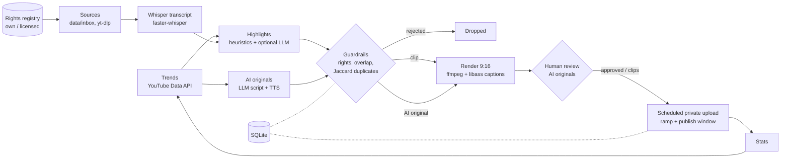

# shorts-engine


[](https://github.com/rakshith-ponnappa/shorts-engine/actions/workflows/ci.yml)

[](LICENSE)

A guardrailed YouTube Shorts pipeline. It finds trends with the YouTube Data API, clips your own or rights-cleared long-form videos (or generates AI originals), adds Whisper captions and TTS, and schedules private uploads on a conservative, config-driven ramp.

> **Status: early-stage.** It works end-to-end for a single owner and channel, but interfaces and config keys may change. Run `--dry-run` first and expect rough edges.

## Content policy & responsible use

This tool can publish to a real channel on a schedule. You are responsible for everything it uploads. The defaults are deliberately cautious. Keep them that way unless you have a good reason.

- **Rights-cleared or own content only.** Nothing is clipped unless it comes from the rights registry in `config.yaml`: your own videos (`kind: own`), or `kind: licensed` sources with a written `permission_ref` (clipping-program terms, an email, a contract). Licensed URLs without a `permission_ref` are refused. Re-uploading other creators' work without permission is copyright infringement and gets channels struck.
- **YouTube's reused-content and spam policies.** YouTube's [reused content](https://support.google.com/youtube/answer/1311392) rules and its [spam, deceptive practices & scams](https://support.google.com/youtube/answer/2801973) policies (including repetitive or mass-produced content) apply to every upload. Clips get a hook, captions, a credit line and, with an LLM, a spoken take so they aren't bare re-uploads. Duplicate checks (transcript Jaccard shingles, time overlap with earlier clips from the same source, duplicate titles) reject near-repeats. None of this guarantees compliance. Read the policies and the YouTube Partner Program terms yourself.
- **AI disclosure.** AI originals are uploaded with `status.containsSyntheticMedia = true` (`guardrails.synthetic_disclosure: true`). Prompts forbid invented quotes or statistics, impersonation and misleading titles.
- **Human review.** AI originals are held in a review queue (`guardrails.review_ai_originals: true`) and are never uploaded until you approve them with `shorts-engine review --approve <id>`. High-risk scripts are always held, whatever the setting.
- **Conservative defaults.** The upload ramp starts at **1 per day** and tops out at **3 per day**. Uploads are always `private` with a scheduled `publishAt`, subscribers aren't notified, and every batch re-checks that the OAuth login belongs to the configured channel. Raise volume only after you've reviewed the results and your channel's policy standing. More volume never justifies turning off guardrails.

## How it works



| Stage | What it does |
|---|---|
| Trends | Finds the most-viewed recent uploads for your niche keywords (and optionally the `mostPopular` charts), drops off-topic hits, scores keywords by view velocity, and adds weight from your own top performers and any seed keywords |
| Sources | Uses only what the rights registry in `config.yaml` lists: your own videos in `data/inbox/`, or licensed URLs with a recorded `permission_ref` |
| Highlights | Whisper transcript with word timings → 20–58 s windows → scores for hook, pace and trend match → optional LLM re-rank that also writes the title, hook, commentary and tags |
| AI originals | LLM script on a trending topic → TTS narration → captions over your b-roll in `assets/backgrounds/` (or a gradient) |
| Guardrails | Rights check, no overlap with earlier clips from the same source, no duplicate titles or near-duplicate transcripts, AI originals held for review, synthetic-media disclosure |
| Render | 1080×1920, blurred fill background, word-by-word highlighted captions, hook text, credit line, spoken commentary intro, −14 LUFS audio |
| Upload | Resumable upload as `private` with `publishAt`, spread across the publish window, stops cleanly when the quota is hit |
| Stats | Pulls views, likes and comments for the last 14 days of uploads, which feed back into trend scoring |

**Stack:** Python 3.10+, Google OAuth (Desktop client), OpenAI or Azure OpenAI, faster-whisper, yt-dlp, ffmpeg with libass, SQLite.

## Quickstart

1. **Install ffmpeg with libass** (needed for burned-in captions):

   ```bash
   brew install ffmpeg-full        # macOS
   sudo apt install ffmpeg         # Debian/Ubuntu
   ```

2. **Install the package and copy the config templates:**

   ```bash
   git clone https://github.com/rakshith-ponnappa/shorts-engine.git && cd shorts-engine
   python3 -m venv .venv && .venv/bin/pip install -e '.[all]'
   cp config.example.yaml config.yaml   # campaign dates, rights registry, mix, channel_id
   cp .env.example .env                 # API keys (never commit this file)
   ```

3. **Create an OAuth Desktop client** in Google Cloud (see [Google API setup](#google-api-setup)) and save its JSON as `secrets/client_secret.json`.

4. **Log in as the channel owner:**

   ```bash
   .venv/bin/shorts-engine auth      # opens a browser; refuses a channel other than youtube.channel_id
   .venv/bin/shorts-engine doctor    # checks every setup step
   .venv/bin/shorts-engine run --dry-run
   ```

LLM (optional but recommended): set `llm.provider` to `openai` or `azure` in `config.yaml` and add the keys to `.env`. Without it, clips still work using heuristic scoring and the first sentence as the title, but AI originals and the spoken commentary are skipped.

## Google API setup

The full click-by-click walkthrough is in [docs/youtube-setup.md](docs/youtube-setup.md). In short:

```bash
deploy/gcloud-setup.sh <google-account-email> [project-id]
# creates/uses a project, enables YouTube Data API v3, writes a restricted API key to .env
# override defaults with GCLOUD_ACCOUNT, GCLOUD_PROJECT, GCLOUD_CONFIG, PROJECT_PREFIX, PROJECT_NAME
```

Then in the Cloud Console (Google Auth Platform): configure the consent screen (External), create a **Desktop app** OAuth client, download its JSON to `secrets/client_secret.json`, and run `shorts-engine auth`.

Two Google restrictions matter:

- **Uploads from unverified API projects stay private.** Videos uploaded through the YouTube Data API from a project that hasn't passed a [YouTube API Services compliance audit](https://support.google.com/youtube/contact/yt_api_form) are locked to *private*, so the scheduled `publishAt` never makes them public. Request the audit early. The same form is used for quota increases.
- **"Testing" OAuth apps get 7-day refresh tokens.** For an External OAuth app whose publishing status is *Testing*, Google expires refresh tokens after **7 days**, and the daemon loses its login. Publish the app (production, unverified is fine for a single-owner tool) or re-run `shorts-engine auth` weekly.

The API key is used only for read-only trend lookups. Uploads use the OAuth token in `secrets/token.json`.

## Configuration

`config.yaml` (copied from [`config.example.yaml`](config.example.yaml)) holds the campaign, rights registry, trend, render, LLM, Whisper, YouTube and guardrail settings. The ramp is:

```yaml
campaign:
  ramp:
    start_per_day: 1    # day-1 volume
    max_per_day: 3      # ceiling
    ramp_days: 14       # linear ramp from start to max
```

`shorts-engine plan` prints the resulting day-by-day quota.

Secrets live in `.env` (copied from [`.env.example`](.env.example)). Existing environment variables take precedence.

| Variable | Required | Purpose |
|---|---|---|
| `OPENAI_API_KEY` | if `llm.provider: openai` | OpenAI chat + TTS for titles, commentary and AI originals |
| `AZURE_OPENAI_API_KEY` | if `llm.provider: azure` | Azure OpenAI key |
| `AZURE_OPENAI_ENDPOINT` | if `llm.provider: azure` | Azure OpenAI endpoint URL |
| `AZURE_OPENAI_API_VERSION` | no (default `2024-10-21`) | Azure OpenAI API version |
| `YOUTUBE_API_KEY` | for trends | YouTube Data API key for read-only trend lookups (`deploy/gcloud-setup.sh` writes it) |

## CLI usage

```text
shorts-engine [-c CONFIG] [-v] <command>
```

| Command | What it does |
|---|---|
| `auth` | Authorise uploads via OAuth and confirm the logged-in channel matches `youtube.channel_id` |
| `doctor` | Check ffmpeg, campaign dates, API key, LLM, OAuth client, login and inbox |
| `plan` | Print the daily volume ramp for the campaign |
| `trends [--top N]` | Refresh and show trending keywords |
| `sources` | Sync the rights registry and list registered sources |
| `run [--dry-run] [--day YYYY-MM-DD]` | Run one day's pipeline; `--dry-run` renders and shows the schedule without uploading |
| `review [--approve ID ...] [--reject ID ...] [--approve-all]` | List, approve or reject AI originals waiting for review |
| `status` | Inventory, today's schedule, top performers |
| `daemon [--at HH:MM] [--every-hours N]` | Run daily (plus top-ups) until the campaign ends |

```bash
shorts-engine doctor
shorts-engine plan
shorts-engine sources
shorts-engine run --dry-run
shorts-engine review --approve 12 15 --reject 13
shorts-engine run
shorts-engine daemon --at 06:30
```

To keep it running, use `deploy/com.shorts-engine.daemon.plist` (macOS launchd) or `deploy/shorts-engine.service` (Linux systemd). Replace the `/PATH/TO/...` placeholders first.

Each source gives at most `max_clips_per_source_per_day` clips, and earlier clips are never reused. `run` tells you when sources run short. More sources is what raises volume. Turning off guardrails doesn't.

## Testing

Tests are offline: no YouTube, OpenAI or Google API calls. Heavy optional dependencies are skipped with `pytest.importorskip`, and the ffmpeg render tests skip when no libass-enabled ffmpeg is installed.

```bash
python3 -m venv .venv && .venv/bin/pip install -e '.[dev]'
.venv/bin/python -m pytest -q
```

They cover the duplicate guardrail (shingles, Jaccard, time overlap, titles), the rights registry, the ramp/quota calculation, publish-slot spacing, config loading and validation, captions, highlight scoring and trend aggregation. CI runs them on Python 3.10, 3.11 and 3.12.

## Layout

```text
shorts-engine/
├── src/shorts_engine/
│   ├── cli.py           # argparse entry point (`shorts-engine`)
│   ├── config.py        # config.yaml + .env loading and validation
│   ├── pipeline.py      # daily orchestration: sources → candidates → render → upload
│   ├── guardrails.py    # rights, overlap and duplicate checks
│   ├── schedule.py      # ramp quota, content mix, publish slots
│   ├── sources.py       # rights registry sync, licensed downloads (yt-dlp)
│   ├── trends.py        # YouTube Data API trend discovery and scoring
│   ├── highlights.py    # candidate windows, heuristic + LLM ranking
│   ├── original.py      # AI-original scripts and narration timing
│   ├── transcribe.py    # faster-whisper transcription
│   ├── captions.py      # ASS caption generation
│   ├── render.py        # ffmpeg 9:16 rendering
│   ├── media.py         # ffmpeg/ffprobe helpers
│   ├── llm.py           # OpenAI / Azure OpenAI chat + TTS
│   ├── youtube.py       # OAuth, channel check, uploads, stats
│   └── db.py            # SQLite schema and helpers
├── tests/               # offline pytest suite
├── deploy/              # gcloud setup script, launchd and systemd units
├── docs/youtube-setup.md
├── assets/backgrounds/  # your licensed b-roll for AI originals (gitignored)
├── config.example.yaml
└── .env.example
```

Runtime state (`data/`, `secrets/`, `config.yaml`, `.env`) is gitignored.

## Roadmap

- [ ] Integration tests for the pipeline with mocked YouTube and LLM clients
- [ ] Per-source attribution templates and stricter licence metadata (expiry, scope)
- [ ] Review UI (local web page) instead of CLI-only review
- [ ] Optional human review for clips, not only AI originals
- [ ] Policy lint for titles and descriptions before upload
- [ ] Packaging on PyPI and a container image with ffmpeg + libass

## Security

See [SECURITY.md](SECURITY.md). Never commit `.env`, `config.yaml`, `secrets/` or OAuth token files.

## License

[MIT](LICENSE) © 2026 Rakshith Ponnappa
